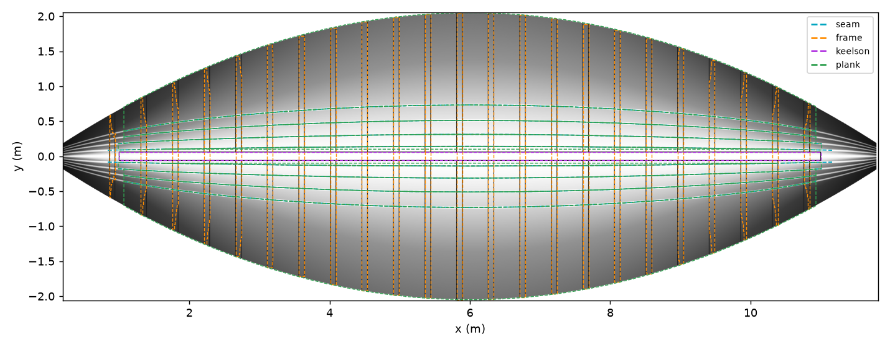
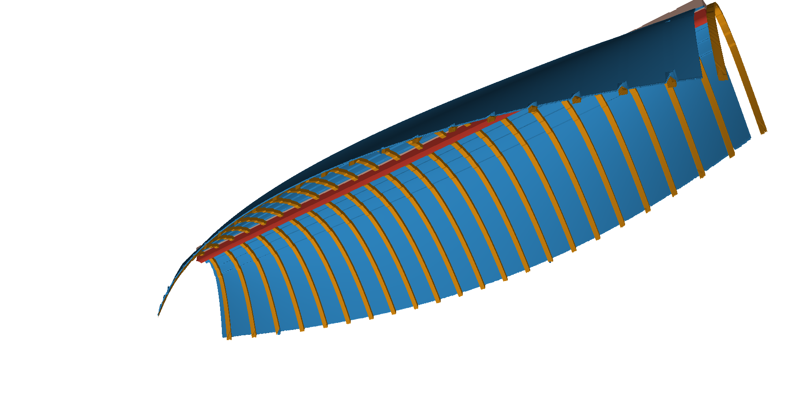
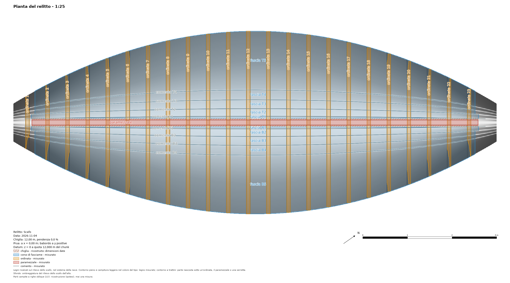
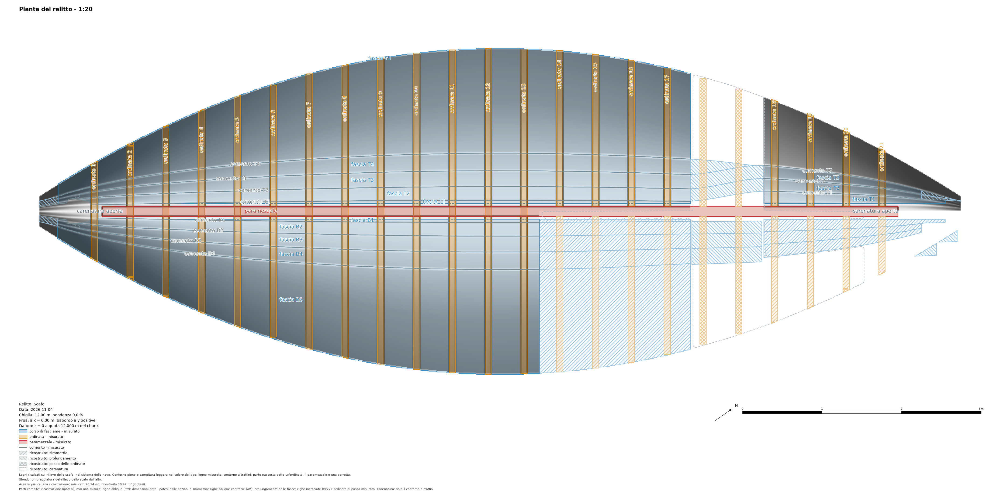
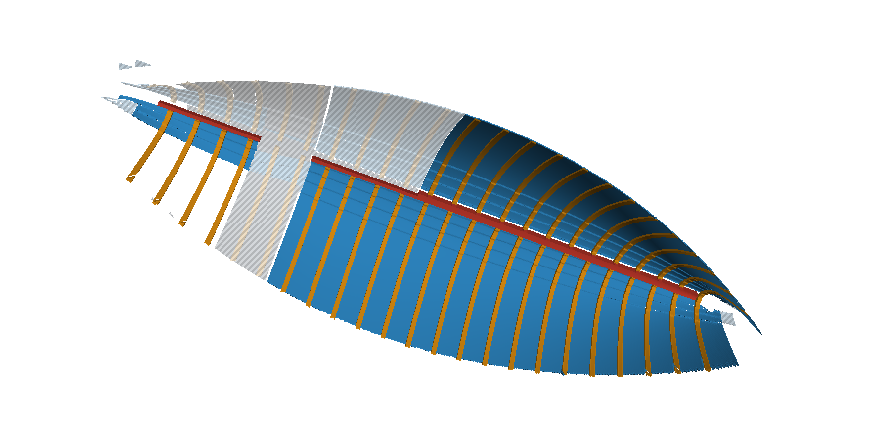

<!-- Sezioni da aggiungere alla guida del programma docs/plugins/shipwreck.it.md per le versioni 0.3.0 e 0.4.0 del
plugin (serve pyarchinit-photogrammetry 1.7.1 o successiva). Posto suggerito: dopo "Fasce a clinker", prima di "Riga di
comando"; le righe di comando vanno in "Riga di comando"; le figure di img/ accanto alle immagini della guida. -->

## Rilievo, ricalco, legni 3D e pianta del relitto

Il passo 8 del pannello, **Rilievo e ricalco**, porta il modello 3D di uno scafo scavato al disegno che fa
l'archeologo sul campo: ogni legno contornato, nominato e tipizzato in una pianta, e ogni legno un oggetto 3D. Serve il
sistema della nave (passo 1); stazioni e sezioni non servono.

| Pulsante | Che cosa fa |
|---|---|
| *Rilievo dello scafo...* | Lo scafo visto dall'alto nel sistema della nave: un prospetto del programma su un piano orizzontale (u = x, v = segno × y: y alla sinistra di x, qualunque sia il capo della prua), le sue altezze, l'ombreggiatura e il rilievo locale. |
| *Mostra* | Il rilievo nella vista raster, con le altezze, l'ombreggiatura o il rilievo locale in grigio sopra. |
| *Proponi...* | Comenti, ordinate, paramezzale, serrette e fasce letti sul rilievo: proposte, tratteggiate, un colore per tipo. |
| *Accetta* / *Scarta* | Le proposte selezionate sulla vista nel catalogo dei legni / buttate per sempre (anche *Canc* sulla vista). |
| *Correggi...* / *Aggiungi...* | Un legno ridisegnato, o uno nuovo disegnato a mano, sul rilievo, con gli strumenti di disegno e lo snap del programma. |
| *Nomi da tabella...* | Una tabella `nome, x`: le ordinate prendono i nomi del cantiere. |
| *Sciolto* | I legni selezionati segnati come fuori posto. |
| *Chiglia (dimensioni)...* | Una chiglia da larghezza e altezza date: un'ipotesi. |
| *Legni 3D...* | Ogni poligono ricalcato un oggetto 3D chiuso. |
| *Esporta 3D...* | OBJ, GLB o IFC, un oggetto per legno, con le tabelle. |
| *Pianta del relitto...* | La pianta con ogni legno contornato, colorato per tipo e nominato: SVG, PDF, PNG, DXF. |

Ogni modifica del catalogo, delle proposte o della chiglia è un passo di *Modifica > Annulla* (proposte e legni
eliminati insieme sulla vista sono un passo solo).

### Il rilievo dello scafo

Il modello è letto dall'alto nel sistema della nave: per ogni cella la superficie più alta del modello (l'interno di uno
scafo adagiato sul fondo), un GeoTIFF in metri della nave con il sistema nei tag, e una copia orientata a nord nel sistema
del chunk per il GIS. L'ombreggiatura da quattro direzioni e il rilievo locale si vedono in grigio sopra, come il
programma fa per un DEM. La cella viene dalla densità del modello; 5 mm va bene per un modello ravvicinato di uno scafo
(un modello di 15 milioni di facce richiede circa un minuto). I disegni fatti sul rilievo restano con lui quando lo
rifai, anche dopo un cambio del sistema della nave.

Il rilievo è un campo di altezze: una quota per cella, la più alta. Ciò che dall'alto, nel sistema della nave, non si
vede non c'è, e quindi non c'è nelle proposte né nei legni 3D: un sottosquadro, un fianco più ripido della verticale, la
faccia di sotto di un legno, un legno sotto un altro, la faccia esterna del fasciame. Per un relitto visto dall'interno
significa: il fasciame è la sua faccia interna (lo spessore viene dai gradini dei comenti, dal modello delle fasce o dal
valore che scrivi), la chiglia non si vede (per questo la chiglia di dimensioni date), le ordinate sono la loro parte
visibile sopra il fasciame e ciò che sta sotto le ordinate è interpolato. Uno scafo adagiato su un fianco vuole un
sistema della nave suo, perché la parte che interessa si veda dall'alto.

### Le proposte



Il plugin legge sul raster delle altezze:

- i **comenti** (i gradini del fasciame a clinker): salti di traverso allo scafo, seguiti lungo x, interrotti nelle
  lacune, una linea ciascuno; numerati dalla chiglia (`comento B1`, `B2`, ... a babordo, `T1`, ... a tribordo); un pezzo
  che cade fra due comenti già presenti è un dubbio `comento B?` con punteggio 0,1;
- le **ordinate**, il **paramezzale** e le **serrette**: ciò che sporge dal fasciame (l'altezza sopra un'apertura lungo x,
  tolta prima la salita del fondo lungo x, così che un'ordinata tenga tutto il suo contorno dove lo scafo sale verso
  prua e poppa), come poligoni, classificati per lunghezza e direzione; le ordinate nominate dalla prua, con la loro
  larghezza e il passo per lato. Un elemento di traverso che manca solo la prova dell'allungamento (lungo fra 1,8 e 3
  volte la larghezza: quasi sempre un'ordinata unita alla vicina o a fasciame rialzato) è un dubbio `ordinata ?` con
  punteggio 0,1: accettalo e correggine il contorno;
- le **fasce**: le bande fra comenti consecutivi, un poligono ciascuna, `fascia B1`, ...; la banda 1 va dalla linea di
  chiglia (spostata di metà larghezza della chiglia) al comento 1, e ogni banda comincia e finisce dove cominciano e
  finiscono i pezzi dei suoi comenti, così dove i comenti interni non si leggono le bande sono rettangoli. Una banda
  larga più di 1,5 volte le altre bande fra comenti del suo lato, o stesa per lo più sopra paramezzale e serrette
  proposti, è una dubbia `fascia B?` con punteggio 0,1.

| Parametro | Predefinito | Quando cambiarlo |
|---|---|---|
| Il modello mostra | l'interno | *L'esterno* per uno scafo sollevato: decide il verso del gradino di un comento. |
| Gradino minimo dei comenti (mm) | 8 | Più basso per un fasciame sottile o consumato; più alto se il rumore del modello dà falsi comenti. |
| Apertura (m) | 0,3 | Più lunga della larghezza fra due ordinate, più corta del fasciame fra due ordinate. |
| Altezza minima di un legno sopra il fasciame (mm) | 20 | Più bassa per ordinate consumate, più alta se vengono proposti grumi di sedimento. |

Tutto è una **proposta**: accettala, correggila o scartala a mano. Una nuova lettura non tocca il catalogo e non
ripropone ciò che è stato accettato o scartato. I limiti, detti chiaramente:

- un legno sciolto di cui si legge un solo bordo dà un comento che non lo è;
- un legno più stretto di 5 cm accanto a un comento può sfuggire;
- un modello che mostra l'esterno dello scafo vuole *L'esterno*, altrimenti ogni comento è dubbio;
- un legno lungo appoggiato a filo lungo quasi tutto un comento rinomina i comenti oltre di lui;
- un avanzo dentro una fascia di larghezza normale è proposto come `comento ?`: accettarlo divide la fascia in due;
- un comento che manca lungo tutto lo scafo dà una banda sola su due fasce;
- un rumore del modello oltre 2 mm spezza i comenti e può aggiungere una fascia;
- pezzi spuri a prua possono prendere il rango 1;
- su un relitto vero ordinate vicine, o con il fasciame fra di loro, sono lette come un elemento largo, proposto come
  `ordinata ?` (o *altro* se ancora più corto): correggine il contorno o ricalca le ordinate a mano con *Aggiungi...*;
  separare le ordinate unite è previsto per una versione successiva; zone piatte di sedimento possono essere proposte come
  paramezzale;
- le fasce sono bande fra i comenti letti, non i contorni delle tavole: dove mancano comenti sono rettangoli sopra
  qualsiasi cosa ci sia (sedimento, legni longitudinali); correggile o ricalcale a mano.

### I legni 3D



*Legni 3D...* fa di ogni legno ricalcato come poligono un oggetto chiuso nel sistema della nave, un PLY per legno in
`<dati del chunk>/shipwreck/timbers/`:

- una **fascia** è la superficie del modello dentro il suo contorno con il suo spessore (il suo, quello del modello delle
  fasce dalle sezioni o il gradino dei suoi comenti; il valore che scrivi vale solo per le fasce senza). Dove un'ordinata,
  il paramezzale o una serretta la coprono, la superficie è interpolata dalla fascia ai due lati e segnata nascosta;
- un'**ordinata**, il **paramezzale**, una **serretta**, il serrettame e ogni altro poligono è un solido dal fasciame sotto
  di lui (interpolato da un anello di celle intorno) fino alla sua cima (la superficie del modello).

Limiti: ricalca tutti i legni che toccano quello che costruisci (uno non ricalcato finisce nell'anello da cui si legge il
fasciame sotto); i file sono grandi sugli scafi lunghi (vedi le dimensioni sotto); un tratto nascosto
con celle da un lato solo è tenuto costante; un legno ricalcato dove sullo scafo non c'è niente dà una mesh di spessore
nullo. Di traverso a un legno lungo lo scafo sotto di lui è una curva per le quote e le pendenze del fasciame ai due
lati (una corda dove le pendenze sono quelle del fianco di un altro legno). Sullo scafo sintetico tutte le 23 ordinate,
da prua a poppa, stanno entro il 2 % del loro volume vero, il paramezzale entro l'1 %, le fasce entro l'1,4 % di quello
sulla superficie a clinker (il torello, una striscia larga 2 cm vista dall'alto, entro il 10 %). Una costruzione
interrotta è detta nel pannello e nell'albero (*interrotto*): i suoi file sono parziali. Quando catalogo, chiglia o
rilievo cambiano dopo la costruzione il pannello dice *da rifare*, e un'esportazione avvisa che i file dicono ciò che il
catalogo diceva allora.

### La chiglia: un'ipotesi

Il modello di uno scafo scavato ne mostra l'interno: la chiglia non si vede. *Chiglia (dimensioni)...* ne fa una da
larghezza e altezza date: un parallelepipedo lungo la linea di chiglia, sotto il fondo del paramezzale (altrimenti sotto
lo scafo a y = 0), lungo tutto il paramezzale (altrimenti tutto il rilievo) o fra due x date. Il suo stato è
*ricostruito: dimensioni date*: è campita nei disegni, più chiara e trasparente (`_ric`) nei file 3D, una riga sua nelle
tabelle; l'intervallo di x resta quello del momento in cui la imposti. Un legno di chiglia ricalcato su un chunk che
mostra l'esterno la sostituisce. *Nessuna chiglia* la toglie.

### Esporta 3D

Un oggetto per legno con il suo nome, nel sistema della nave o nelle coordinate del chunk:

- **OBJ**: `o <nome>` per legno, un materiale per tipo nel `.mtl`;
- **GLB**: un nodo per legno, un colore per tipo;
- **IFC4**: un elemento per legno (IfcPlate per fasciame e serrettame, IfcMember per gli altri) con
  `Pset_PyArchInit_Timber` (nome, tipo, lato, chunk, stato, lunghezza, larghezza, quote, volume, spessore in metri). Un
  chunk in un sistema locale o geografico non ha la IfcMapConversion, e il file lo dice. L'IFC di uno scafo lungo
  richiede da decine di secondi a minuti (sotto);
- le tabelle `timbers_3d.csv` e `.xlsx` accanto (spessore in millimetri).

Dimensioni a 5 mm, misurate su uno scafo sintetico di 12 m (1,9 milioni di celle): proposte 1 s e circa 0,45 GB di
memoria, legni 3D circa 0,75 GB durante la costruzione (le due fasce sui bordi 1,5 milioni di facce ciascuna), file PLY
160 MB, IFC circa 20 s e 290 MB. Uno scafo di 20 m a 5 mm ha circa 16 milioni di celle: conta su diversi GB di memoria
per le proposte (circa 3,5 GB) e i legni 3D, un IFC di qualche GB che richiede minuti e una decina di minuti per il
rilievo di un modello fotogrammetrico. Per le esportazioni 3D di uno scafo lungo costruisci il rilievo a 1 cm (quattro
volte meno celle); la decimazione dei solidi è prevista per una versione successiva.

Le ipotesi finiscono in `_ric`, più chiare e semitrasparenti, con il loro stato nel Pset.

### La pianta del relitto



*Pianta del relitto...* disegna ogni legno del catalogo sopra l'ombreggiatura del rilievo, l'ortofoto o niente:
contornato e campito leggero nel colore del suo tipo, il fasciame più chiaro perché il rilievo sotto resti leggibile,
nominato lungo la sua lunghezza (un'ordinata di traverso, vicino all'estremità lontana dalla chiglia); le parti di una
fascia sotto un'ordinata, il paramezzale o una serretta a trattini; le ricostruzioni (la chiglia data, le fasce dalle
sezioni, le tavole importate dal Clinker Boat Tool) campite a righe oblique (`////`). Legenda per tipo e stato, scala
grafica, nord, cartiglio; SVG, PDF, PNG e DXF con un layer per tipo (`LEGNI_<TIPO>`, `RICOSTRUZIONE_<TIPO>`) in
`<dati del chunk>/shipwreck/drawings`. Con legni ricalcati il piano di costruzione segna le fasce a ogni stazione e il
profilo mostra paramezzale e chiglia. Se il rilievo è da rifare il pannello propone prima di rifarlo.

Il modello delle fasce dalle sezioni (versione 0.2.0) resta disponibile come livello d'ipotesi: una fascia delle sezioni
non è disegnata dove una fascia ricalcata ha il suo nome.

Limiti dei disegni: fasce strette o più serrette che finiscono alla stessa x possono affollare i nomi; un'ordinata che
attraversa la linea di chiglia è nominata all'estremità alta; un legno di chiglia misurato non ha il riquadro sul
profilo; i nomi delle stazioni del piano di costruzione possono sovrapporsi.

## Ricostruzione (ipotesi)

Il passo 9 del pannello, **Ricostruzione (ipotesi)** (versione 0.4.0), completa ciò che il relitto ha perso. Ogni sua
parte è un'ipotesi costruita da ciò che è stato ricalcato e misurato: campita nei disegni, più chiara e trasparente
(`_ric`) nei file 3D, con uno stato suo nelle tabelle; il catalogo dei legni misurati non cambia mai. Servono il rilievo
dello scafo e i legni ricalcati sopra (passo 8); la carenatura vuole anche le stazioni e le loro sezioni (passi 2 e 3).

| Pulsante | Che cosa fa |
|---|---|
| *Prua e poppa...* | Fin dove la ricostruzione può andare oltre la lunghezza rilevata: una x della nave per la prua, per la poppa, o nessuna. |
| *Ricostruisci...* | Simmetria, prolungamento delle fasce, ordinate al passo misurato e carenatura, ognuna facoltativa, in una costruzione sola. |
| *Usa il sistema nave di...* | Il sistema della nave (e le stazioni) di un altro chunk dello stesso relitto; le sezioni rifatte su questo modello. |
| *Tabella...* | Ciò che è misurato e ciò che è ricostruito, legno per legno: `tabella.csv` e `.xlsx`. |
| *Esporta 3D...* | I legni in 3D con la ricostruzione (OBJ, GLB, IFC), e la tabella accanto. |
| *Pianta con ricostruzione...* | La pianta del relitto con la ricostruzione campita. |

Ogni costruzione, e ogni modifica di prua e poppa, è un passo di *Modifica > Annulla*: annullare una costruzione
riporta la ricostruzione di prima, record e file. Per questo la cartella della ricostruzione è copiata una volta per
costruzione in `shipwreck/reconstruction.undo/` (tolta alla sessione successiva); le copie sono collegamenti fisici e
non occupano quasi nulla, ma su un disco senza collegamenti fisici (FAT, exFAT, alcune condivisioni di rete) ognuna è
una copia intera della cartella. L'albero dell'area di lavoro mostra *Ricostruzione (n, ipotesi)*;
mentre il rilievo è mostrato, il layer *Ricostruzione (ipotesi)* disegna sopra i legni ricostruiti campiti e a trattini
(non si modificano a mano: eliminarli lì è rifiutato, con l'indicazione di come toglierli).



### Che cosa viene ricostruito, e i limiti

- **Simmetria.** Un legno del lato conservato è riflesso rispetto al piano di chiglia dove l'altro lato non ha né il
  modello né un record del suo tipo: così come il relitto giace, quindi uno scafo torto o schiacciato è riflesso torto.
  Dove entrambi i lati sono misurati non si riflette niente e la differenza è elencata (la tabella dei disaccordi dei
  due lati, stazione per stazione): un relitto deformato dà disaccordi, non pezzi riflessi. Pezzi più piccoli di
  25 cm², più stretti di 5 cm (a meno che il legno stesso sia stretto) o sopra il modello non sono riflessi.
- **Prolungamento delle fasce.** Una fascia ricalcata su una parte dello scafo continua lungo i suoi due comenti:
  entro la lunghezza rilevata (il rilievo dei chunk) e oltre solo fino a una prua o a una poppa date. I comenti seguono
  le linee dei gradini delle sezioni (passo 7) dove ci sono, altrimenti la curvatura dei loro punti per un metro al
  massimo, poi tenuti dritti: quei pezzi sono segnati `uncertain` (incerti). Un pezzo prolungato è tagliato dove si
  allarga oltre 1,5 volte la larghezza misurata della fascia, o dove il suo bordo esterno supera di più di quella
  larghezza la mezza larghezza dello scafo a quella x (la cella più lontana del rilievo da quel lato; dove quel lato è
  perso, quella dell'altro lato alla stessa x, come assume la simmetria): linee dei gradini rumorose non aprono più una fascia a ventaglio fuori dal relitto.
  Un pezzo tagliato è `uncertain` e nominato negli avvisi.
- **Ordinate al passo misurato.** Dove lo spazio fra due ordinate ricalcate supera di 1,5 volte lo spazio mediano del
  loro lato, le ordinate mancanti sono rimesse a quel passo, in piedi sullo scafo (dal rilievo, dai solidi riflessi o
  dalla carenatura) alte quanto le due vicine.
- **Carenatura.** Una superficie per le sezioni alle stazioni (una mezza sezione con pochi punti prende quella
  dell'altro lato), tenuta solo dove il relitto non mostra niente. Oltre l'ultima stazione si stringe fino
  all'estremità data con una quadratica dalla larghezza e dalla pendenza dell'ultima stazione, con l'altezza
  dell'ultima sezione: un'ipotesi della sola larghezza. Senza prua o poppa date quell'estremità resta aperta all'ultima
  stazione (la pianta scrive *carenatura aperta*). I legni non ricalcati sul fasciame entrano nelle sezioni:
  ricalcali (il paramezzale prima di tutto), altrimenti lo scafo passa sopra di loro.
- **La chiglia** data al passo 8 resta un solido suo; non entra mai nella carenatura.
- **Il profilo** non mostra l'orlo su un tratto perso da entrambi i lati: il bordo alto della carenatura non è
  disegnato come orlo.

### Più chunk dello stesso relitto

Altre campagne o altre parti del relitto in altri chunk entrano nella ricostruzione del chunk attivo quando sono
compatibili: allineati a lui (*Flusso di lavoro > Allinea chunk*) con lo stesso sistema della nave (*Usa il sistema
nave di...* lo copia), oppure con un sistema della nave preso da marker degli stessi nomi. Ognuno ha bisogno del suo
rilievo e dei suoi legni ricalcati; le ordinate devono avere i numeri del cantiere (*Nomi da tabella...*). I record
dello stesso tipo, lato e nome sono uniti nella pianta della nave, con il contorno del chunk misurato meglio dove
entrambi hanno rilevato; ordinate numerate in modo diverso sono unite per posizione; le quote vengono da un rilievo
unito, ogni cella dal chunk migliore; la carenatura passa per le stazioni di tutti i chunk. I chunk esclusi sono
elencati con il motivo (`chunks` dalla riga di comando) e gli avvisi dell'unione sono detti dopo la costruzione. Si
scrivono solo i file del chunk attivo.

### La tabella

`tabella.csv` (codici) e `tabella.xlsx` (titoli): una riga per record misurato, poi per record ricostruito, poi la
carenatura, con `id`, `name`, `kind`, `side`, `status`, `measured_length`, `measured_area` (un record misurato),
`reconstructed_length`, `reconstructed_area` (ogni altro), `length_kind`: `3D` per una linea misurata lungo il modello,
`pianta` per una lunghezza nella pianta della nave (il lato lungo di un poligono, un record unito da più chunk, la
ricostruzione). Le aree sono nella pianta della nave. Con più chunk la tabella elenca i record uniti, come li usano la
costruzione e i file.

### Campiture e file 3D

Sulla pianta, una campitura per modo di ricostruire: righe oblique `////` per la simmetria (e per la chiglia data e le
fasce delle sezioni), righe oblique contrarie `\\\\` per il prolungamento, righe incrociate `xxxx` per le ordinate al
passo, righe orizzontali `----` per le tavole importate dal Clinker Boat Tool; la carenatura è solo il contorno a
trattini. Il DXF ha i layer `RICOSTRUZIONE_<TIPO>` con le campiture ANSI31, ANSI32, ANSI37 e ANSI33 e
`RICOSTRUZIONE_HULL`. Nei file 3D ogni oggetto ricostruito finisce in `_ric`, più chiaro e trasparente; nell'IFC il suo
stato è nel Pset, e una mesh non chiusa (la carenatura) è scritta con `Closed=False`.



Sullo scafo sintetico (lo scafo a clinker con ordinate dei test, il babordo perso da metà nave a poppa ed entrambi i
lati su 0,9 m): i contorni delle fasce riflesse stanno entro 1,1 mm (mediana; p95 4,3 mm) dalle fasce ricalcate sullo
scafo intero, il 99 % entro 1 cm, le loro facce entro 4 mm (p95 8 mm) dalla sua superficie; fasce ricalcate su x 2-9
prolungate fino alle estremità rilevate con i bordi entro 1 mm (p95 3 mm) di traverso e 1 mm (p95 7 mm) in quota dai
comenti veri; le quattro ordinate mancanti rimesse dov'erano; la carenatura entro 0,6 mm (p95) dalla sezione vera; una
costruzione di tutta la ricostruzione 1,4 s, il suo IFC (68 elementi, 33 `_ric`) 7 s. Due chunk dello stesso scafo
(0-7 m e 6-12 m) danno una ricostruzione sola su tutta la lunghezza rilevata.

<!-- Righe da aggiungere a "Riga di comando": -->

```bash
ppg plugin shipwreck relief build PROGETTO.ppg [--cell MM]
ppg plugin shipwreck relief export PROGETTO.ppg --kind height|hillshade|slrm --out FILE.tif [--world]
ppg plugin shipwreck propose PROGETTO.ppg [--view inside|outside] [--min-step MM] [--opening M] [--top-hat MM]
ppg plugin shipwreck trace list PROGETTO.ppg
ppg plugin shipwreck trace accept PROGETTO.ppg ID... [--name NOME]     # oppure --kind frame [--min-score 0.5]
ppg plugin shipwreck trace reject PROGETTO.ppg ID...
ppg plugin shipwreck trace names PROGETTO.ppg --table FILE             # nome, x: i nomi delle ordinate
ppg plugin shipwreck keel PROGETTO.ppg --siding MM --moulding MM [--from X --to X]   # oppure --none
ppg plugin shipwreck solids PROGETTO.ppg [--thickness MM]
ppg plugin shipwreck export3d PROGETTO.ppg --out FILE.obj|.glb|.ifc [--world] [--no-tables]
ppg plugin shipwreck plan PROGETTO.ppg [--background relief|ortho|none] [--scale N] [--out CARTELLA]
ppg plugin shipwreck status PROGETTO.ppg                               # con i conteggi dei legni 3D
ppg plugin shipwreck ends PROGETTO.ppg [--stem X] [--stern X]          # oppure --none: solo entro la lunghezza rilevata
ppg plugin shipwreck frame-of PROGETTO.ppg CHUNK [--chunk QUESTO]      # il sistema della nave di un altro chunk
ppg plugin shipwreck chunks PROGETTO.ppg                               # i chunk della ricostruzione, e perché no gli altri
ppg plugin shipwreck reconstruct PROGETTO.ppg [--no-mirror] [--no-extension] [--no-frames] [--no-loft]
ppg plugin shipwreck reconstruct table PROGETTO.ppg [--out CARTELLA]   # tabella.csv e .xlsx
ppg plugin shipwreck export3d PROGETTO.ppg --out FILE.obj|.glb|.ifc --reconstruction
ppg plugin shipwreck plan PROGETTO.ppg --reconstruction [--out CARTELLA]
```
