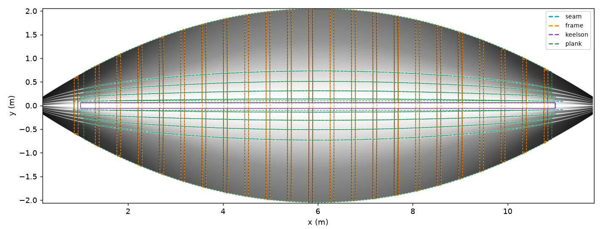
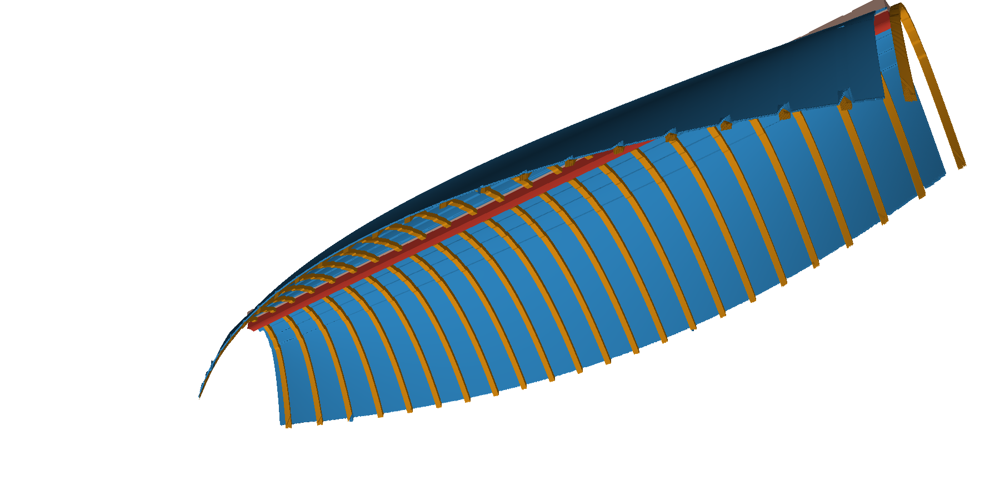
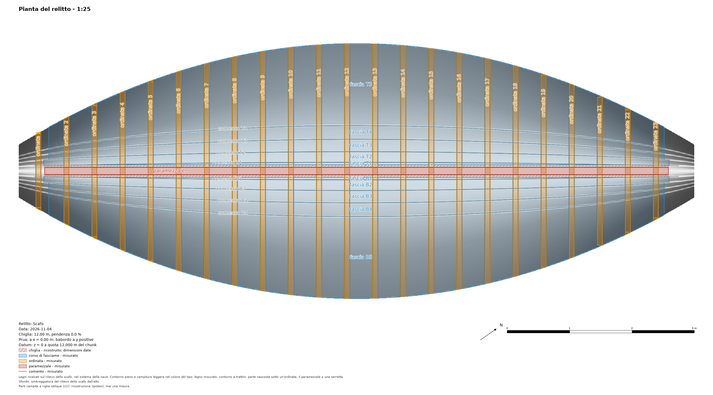

<!-- Sections to add to the program's guide docs/plugins/shipwreck.md for version 0.3.0 of the plugin (needs
pyarchinit-photogrammetry 1.7.1 or later). Suggested place: after "Clinker strakes", before "Command line"; the
command lines go into "Command line"; the figures of img/ go beside the guide's images. -->

## Relief, tracing, 3D timbers and the plan of the wreck

Step 8 of the pane, **Relief and tracing**, turns the 3D model of an excavated hull into the drawing a field
archaeologist makes: every timber outlined, named and typed on a plan, and every timber a 3D object. It needs the ship
frame (step 1); the stations and the sections are not needed.

| Button | What it does |
|---|---|
| *Relief of the hull...* | The hull seen from above in the ship frame: an elevation of the program on a horizontal plane (u = x, v = y), its heights, hillshade and local relief model. |
| *Show* | The relief in the raster view, with the heights, the hillshade or the local relief in grey over it. |
| *Propose...* | Seams, frames, keelson, stringers and strakes read on the relief: proposals, dashed, a colour per kind. |
| *Accept* / *Reject* | The proposals selected on the view into the timber catalogue / thrown away for good (*Delete* on the view rejects too). |
| *Correct...* / *Add...* | A timber traced again, or a new one traced by hand, on the relief, with the program's drawing tools and snap. |
| *Names from a table...* | A table `name, x`: the frames take the field's names. |
| *Loose* | The selected timbers flagged as out of place. |
| *Keel (dimensions)...* | A keel from a given siding and moulding: a hypothesis. |
| *3D timbers...* | Every traced polygon a closed 3D object. |
| *Export 3D...* | OBJ, GLB or IFC, one object per timber, with the tables. |
| *Plan of the wreck...* | The plan with every timber outlined, coloured by kind and named: SVG, PDF, PNG, DXF. |

Every change of the catalogue, the proposals or the keel is a step of *Edit > Undo* (deleting proposals and timbers
together on the view is one step).

### The relief of the hull

The model is read from above in the ship frame: per cell the highest surface of the model (the inside of a hull lying
on its bottom), a GeoTIFF in ship metres with the frame in its tags, and a north-up copy in the chunk's system for GIS.
Its hillshade from four directions and its local relief model are shown in grey over it, as the program does for a DEM.
The cell comes from the model's density; 5 mm suits a close-range model of a hull (a model of 15 million faces takes
about a minute). The drawings made on the relief stay with it when you build it again, also after the ship frame
changed.

The relief is a height field: one height per cell, the highest. Whatever cannot be seen from above in the ship frame is
not in it, and so not in the proposals nor in the 3D timbers: an undercut, a side steeper than vertical, the underside of
a timber, a timber lying under another, the outer face of the planking. For a wreck seen from inside this means: the
planking is its inner face (its thickness comes from the steps of the seams, the strake model or the value you type),
the keel is not seen (hence the keel of given dimensions), the frames are their visible part above the planking, and
whatever lies under the frames is interpolated. A hull lying on its side needs a ship frame of its own so that the part
you want is seen from above.

### The proposals



The plugin reads on the height raster:

- **seams** (the lands of a clinker planking): steps across the hull, followed along x, broken at gaps, a line each;
  numbered from the keel (`comento B1`, `B2`, ... to port, `T1`, ... to starboard); a piece that falls between two lands
  already there is a doubtful `comento B?` with a score of 0.1;
- **frames**, the **keelson** and the **stringers**: what stands above the planking (the heights above an opening along
  x, on the floor's rise along x taken out first, so that a frame keeps its whole outline where the hull rises toward
  stem and stern), as polygons, classified by length and direction; the frames named from the bow, with their room and
  the frame space per side. A transverse item that fails only the elongation test (between 1.8 and 3 times as long as
  wide: most often a frame merged with its neighbour or with raised planking) is a doubtful `ordinata ?` with a score of
  0.1: accept it and correct its outline;
- **strakes**: the bands between consecutive seams, a polygon each, `fascia B1`, ...; band 1 runs from the keel line
  (offset by the keel's half width) to seam 1, and each band starts and stops where the pieces of its seams do, so where
  the inner seams are not read the bands are boxes. A band more than 1.5 times as wide as the side's other bands
  between seams, or lying mostly over the proposed keelson and stringers, is a doubtful `fascia B?` with a score of 0.1.

| Parameter | Default | When to change it |
|---|---|---|
| The model shows | the inside | *The outside* for a lifted hull: it decides which way a land's step goes. |
| Least step of a seam (mm) | 8 | Lower for thin planking or a worn hull; higher if the noise of the model makes false seams. |
| Opening (m) | 0.3 | Longer than the room between two frames, shorter than the planking between two frames. |
| Least height of a timber over the planking (mm) | 20 | Lower for worn frames, higher if lumps of sediment are proposed. |

Everything is a **proposal**: accept, correct or reject it by hand. A new reading never touches the catalogue and never
proposes again what was accepted or rejected. The limits, plainly:

- a loose timber of which only one edge is read gives a seam that is not one;
- a timber narrower than 5 cm beside a land may be missed;
- a model showing the outside of the hull needs *The outside*, otherwise every seam is doubtful;
- a long timber lying flush along almost the whole length of a land renames the lands beyond it;
- a remnant in a strake of normal width is proposed as `comento ?`: accepting it splits the strake in two;
- a land missing along the whole hull gives one band over two strakes;
- noise of the model beyond 2 mm breaks the seams into pieces and may add a strake;
- strays at the bow may take rank 1;
- on a real wreck frames lying close together, or with planking between them, are read as one wide item, proposed as
  `ordinata ?` (or *other* when even shorter): correct the outline, or trace the frames by hand with *Add...*; splitting
  merged frames is planned for version 0.4.0; flat patches of sediment may be proposed as a keelson;
- the strakes are bands between the seams read, not the outlines of the planks: where seams are missing they are boxes
  over whatever lies there (sediment, longitudinal timbers); correct or trace them by hand.

### The 3D timbers



*3D timbers...* makes every timber traced as a polygon a closed object in the ship frame, one PLY per timber in
`<chunk data>/shipwreck/timbers/`:

- a **strake** is the model's surface inside its outline with its thickness (its own, that of the strake model of the
  sections, or the step of its seams; the value you type only for the strakes with none). Where a frame, the keelson or
  a stringer lies on it, the surface is interpolated from the strake on both sides and flagged hidden;
- a **frame**, the **keelson**, a **stringer**, the ceiling and any other polygon is a solid from the planking under it
  (interpolated from a ring of cells around it) up to its top (the model's surface).

Limits: trace every timber touching the one you build (an untraced one ends up in the ring the planking under it is read
from); the files are large on long hulls (about 100 bytes per cell, no decimation); a hidden span with cells on one side
only is held constant; a timber traced where nothing stands on the hull gives a mesh of zero thickness. Across a long
timber the hull under it is a curve through the heights and slopes of the planking on both sides (a chord where the
slopes are those of another timber's side). On the synthetic hull all 23 frames, from stem to stern, come within 2 %
of their true volume, the keelson within 1 %, the strakes within 1.4 % of the clinker surface's (the garboard, a strip
2 cm wide seen from above, within 10 %). A cancelled build is said in the pane and the tree (*interrupted*): its
files are partial. When the catalogue, the keel or the relief changes after the build the pane says *to build again*,
and an export warns that the files say what the catalogue said then.

### The keel: a hypothesis

The model of an excavated hull shows its inside: the keel is not seen. *Keel (dimensions)...* makes one from a siding and
a moulding you give: a box along the keel line, under the keelson's bottom (else under the hull at y = 0), along the
whole keelson (else the whole relief) or between two x you give. Its status is *reconstructed: given dimensions*: it is
hatched in the drawings, lighter and translucent (`_ric`) in the 3D files and a row of its own in the tables; its x
range is fixed when you set it. A keel record traced on a chunk that shows the outside replaces it. *No keel* removes it.

### Export 3D

One object per timber with its name, in the ship frame or in the chunk's coordinates:

- **OBJ**: `o <name>` per timber, a material per kind in the `.mtl`;
- **GLB**: a node per timber, a colour per kind;
- **IFC4**: an element per timber (IfcPlate for planks and ceiling, IfcMember for the others) with
  `Pset_PyArchInit_Timber` (name, kind, side, chunk, status, length, width, heights, volume, thickness in metres). A
  chunk in a local or geographic system gets no map conversion, and the file says so. An IFC of a long hull may take
  tens of seconds;
- the tables `timbers_3d.csv` and `.xlsx` beside it (thickness in millimetres).

Hypotheses end in `_ric`, lighter and half transparent, with their status in the Pset.

### The plan of the wreck



*Plan of the wreck...* draws every timber of the catalogue over the hillshade of the relief, the orthophoto or nothing:
outlined and lightly filled in its kind's colour, the planking lighter so that the relief under it stays readable,
named along its length (a frame across, near its end away from the keel); the parts of a strake under a frame, the
keelson or a stringer dashed; reconstructions (the given keel, the strakes of the sections, the planks imported from the
Clinker Boat Tool) hatched with oblique lines (`////`). Legend per kind and status, scale bar, north, title block; SVG,
PDF, PNG and DXF with a layer per kind (`LEGNI_<KIND>`, `RICOSTRUZIONE_<KIND>`) in `<chunk data>/shipwreck/drawings`.
With traced timbers the body plan marks the strakes at each station and the profile shows the keelson and the keel.
When the relief is stale the pane offers to build it again first.

The strake model of the sections (version 0.2.0) stays available as a hypothesis layer: a strake of the sections is not
drawn where a traced strake has its name.

Limits of the drawings: narrow strakes or several stringers ending at one x may crowd their names; a frame crossing the
keel line is named at its top end; a measured keel record has no box on the profile; the station names of the body plan
may overlap.

<!-- Lines to add to "Command line": -->

```bash
ppg plugin shipwreck relief build PROJECT.ppg [--cell MM]
ppg plugin shipwreck relief export PROJECT.ppg --kind height|hillshade|slrm --out FILE.tif [--world]
ppg plugin shipwreck propose PROJECT.ppg [--view inside|outside] [--min-step MM] [--opening M] [--top-hat MM]
ppg plugin shipwreck trace list PROJECT.ppg
ppg plugin shipwreck trace accept PROJECT.ppg ID... [--name NAME]      # or --kind frame [--min-score 0.5]
ppg plugin shipwreck trace reject PROJECT.ppg ID...
ppg plugin shipwreck trace names PROJECT.ppg --table FILE              # name, x: the names of the frames
ppg plugin shipwreck keel PROJECT.ppg --siding MM --moulding MM [--from X --to X]   # or --none
ppg plugin shipwreck solids PROJECT.ppg [--thickness MM]
ppg plugin shipwreck export3d PROJECT.ppg --out FILE.obj|.glb|.ifc [--world] [--no-tables]
ppg plugin shipwreck plan PROJECT.ppg [--background relief|ortho|none] [--scale N] [--out FOLDER]
ppg plugin shipwreck status PROJECT.ppg                                # with the counts of the 3D timbers
```
