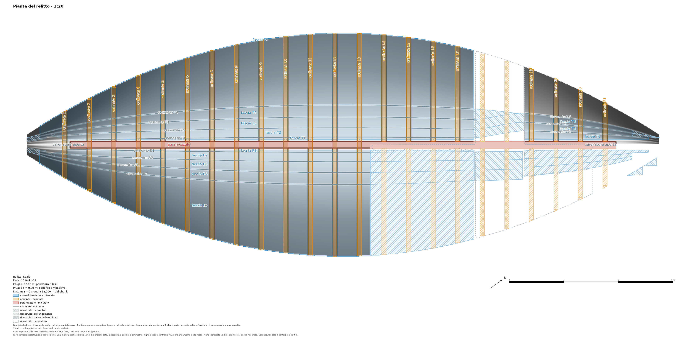
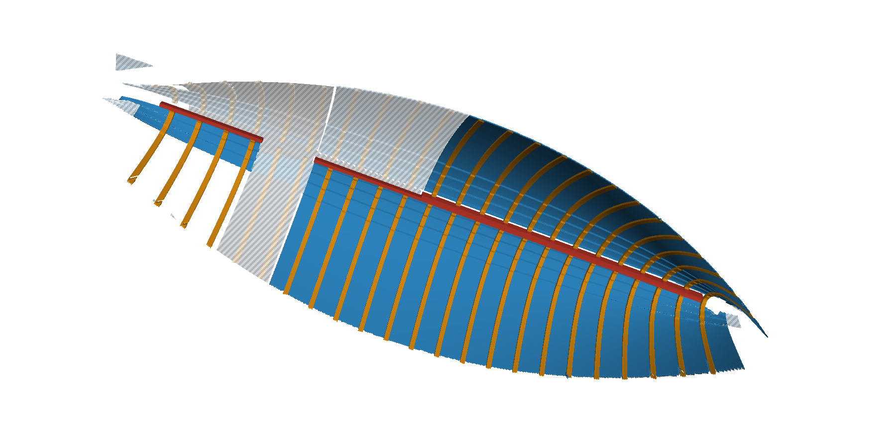

<!-- Sections to add to the program's guide docs/plugins/shipwreck.md for versions 0.3.0 and 0.4.0 of the plugin
(needs pyarchinit-photogrammetry 1.7.1 or later). Suggested place: after "Clinker strakes", before "Command line"; the
command lines go into "Command line"; the figures of img/ go beside the guide's images. -->

## Relief, tracing, 3D timbers and the plan of the wreck

Step 8 of the pane, **Relief and tracing**, turns the 3D model of an excavated hull into the drawing a field
archaeologist makes: every timber outlined, named and typed on a plan, and every timber a 3D object. It needs the ship
frame (step 1); the stations and the sections are not needed.

| Button | What it does |
|---|---|
| *Relief of the hull...* | The hull seen from above in the ship frame: an elevation of the program on a horizontal plane (u = x, v = sign × y: y to the left of x, whichever end is the bow), its heights, hillshade and local relief model. |
| *Show* | The relief in the raster view, with the heights, the hillshade or the local relief in grey over it. |
| *Propose...* | Seams, frames, keelson, stringers and strakes read on the relief: proposals, dashed, a colour per kind. |
| *Accept* / *Reject* | The proposals selected on the view into the timber catalogue / thrown away for good (*Delete* on the view rejects too). |
| *Correct...* / *Add...* | A timber traced again, or a new one traced by hand, on the relief, with the program's drawing tools and snap. |
| *Names from a table...* | A table `name, x`: the frames take the field's names. |
| *Loose* | The selected timbers flagged as out of place. |
| *Keel (dimensions)...* | A keel from a given siding and moulding: a hypothesis. |
| *3D timbers...* | Every traced polygon a closed 3D object. |
| *Export 3D...* | OBJ, GLB or IFC, one object per timber, with the tables. |
| *Plan of the wreck...* | The plan with every timber outlined, coloured by kind and named: SVG, PDF, PNG, DXF. |

Every change of the catalogue, the proposals or the keel is a step of *Edit > Undo* (deleting proposals and timbers
together on the view is one step).

### The relief of the hull

The model is read from above in the ship frame: per cell the highest surface of the model (the inside of a hull lying
on its bottom), a GeoTIFF in ship metres with the frame in its tags, and a north-up copy in the chunk's system for GIS.
Its hillshade from four directions and its local relief model are shown in grey over it, as the program does for a DEM.
The cell comes from the model's density; 5 mm suits a close-range model of a hull (a model of 15 million faces takes
about a minute). The drawings made on the relief stay with it when you build it again, also after the ship frame
changed.

The relief is a height field: one height per cell, the highest. Whatever cannot be seen from above in the ship frame is
not in it, and so not in the proposals nor in the 3D timbers: an undercut, a side steeper than vertical, the underside of
a timber, a timber lying under another, the outer face of the planking. For a wreck seen from inside this means: the
planking is its inner face (its thickness comes from the steps of the seams, the strake model or the value you type),
the keel is not seen (hence the keel of given dimensions), the frames are their visible part above the planking, and
whatever lies under the frames is interpolated. A hull lying on its side needs a ship frame of its own so that the part
you want is seen from above.

### The proposals


The plugin reads on the height raster:

- **seams** (the lands of a clinker planking): steps across the hull, followed along x, broken at gaps, a line each;
  numbered from the keel (`comento B1`, `B2`, ... to port, `T1`, ... to starboard); a piece that falls between two lands
  already there is a doubtful `comento B?` with a score of 0.1;
- **frames**, the **keelson** and the **stringers**: what stands above the planking (the heights above an opening along
  x, on the floor's rise along x taken out first, so that a frame keeps its whole outline where the hull rises toward
  stem and stern), as polygons, classified by length and direction; the frames named from the bow, with their room and
  the frame space per side. A transverse item that fails only the elongation test (between 1.8 and 3 times as long as
  wide: most often a frame merged with its neighbour or with raised planking) is a doubtful `ordinata ?` with a score of
  0.1: accept it and correct its outline;
- **strakes**: the bands between consecutive seams, a polygon each, `fascia B1`, ...; band 1 runs from the keel line
  (offset by the keel's half width) to seam 1, and each band starts and stops where the pieces of its seams do, so where
  the inner seams are not read the bands are boxes. A band more than 1.5 times as wide as the side's other bands
  between seams, or lying mostly over the proposed keelson and stringers, is a doubtful `fascia B?` with a score of 0.1.

| Parameter | Default | When to change it |
|---|---|---|
| The model shows | the inside | *The outside* for a lifted hull: it decides which way a land's step goes. |
| Least step of a seam (mm) | 8 | Lower for thin planking or a worn hull; higher if the noise of the model makes false seams. |
| Opening (m) | 0.3 | Longer than the room between two frames, shorter than the planking between two frames. |
| Least height of a timber over the planking (mm) | 20 | Lower for worn frames, higher if lumps of sediment are proposed. |

Everything is a **proposal**: accept, correct or reject it by hand. A new reading never touches the catalogue and never
proposes again what was accepted or rejected. The limits, plainly:

- a loose timber of which only one edge is read gives a seam that is not one;
- a timber narrower than 5 cm beside a land may be missed;
- a model showing the outside of the hull needs *The outside*, otherwise every seam is doubtful;
- a long timber lying flush along almost the whole length of a land renames the lands beyond it;
- a remnant in a strake of normal width is proposed as `comento ?`: accepting it splits the strake in two;
- a land missing along the whole hull gives one band over two strakes;
- noise of the model beyond 2 mm breaks the seams into pieces and may add a strake;
- strays at the bow may take rank 1;
- on a real wreck frames lying close together, or with planking between them, are read as one wide item, proposed as
  `ordinata ?` (or *other* when even shorter): correct the outline, or trace the frames by hand with *Add...*; splitting
  merged frames is planned for a later version; flat patches of sediment may be proposed as a keelson;
- the strakes are bands between the seams read, not the outlines of the planks: where seams are missing they are boxes
  over whatever lies there (sediment, longitudinal timbers); correct or trace them by hand.

### The 3D timbers


*3D timbers...* makes every timber traced as a polygon a closed object in the ship frame, one PLY per timber in
`<chunk data>/shipwreck/timbers/`:

- a **strake** is the model's surface inside its outline with its thickness (its own, that of the strake model of the
  sections, or the step of its seams; the value you type only for the strakes with none). Where a frame, the keelson or
  a stringer lies on it, the surface is interpolated from the strake on both sides and flagged hidden;
- a **frame**, the **keelson**, a **stringer**, the ceiling and any other polygon is a solid from the planking under it
  (interpolated from a ring of cells around it) up to its top (the model's surface).

Limits: trace every timber touching the one you build (an untraced one ends up in the ring the planking under it is read
from); the files are large on long hulls (see the sizes below); a hidden span with cells on one side
only is held constant; a timber traced where nothing stands on the hull gives a mesh of zero thickness. Across a long
timber the hull under it is a curve through the heights and slopes of the planking on both sides (a chord where the
slopes are those of another timber's side). On the synthetic hull all 23 frames, from stem to stern, come within 2 %
of their true volume, the keelson within 1 %, the strakes within 1.4 % of the clinker surface's (the garboard, a strip
2 cm wide seen from above, within 10 %). A cancelled build is said in the pane and the tree (*interrupted*): its
files are partial. When the catalogue, the keel or the relief changes after the build the pane says *to build again*,
and an export warns that the files say what the catalogue said then.

### The keel: a hypothesis

The model of an excavated hull shows its inside: the keel is not seen. *Keel (dimensions)...* makes one from a siding and
a moulding you give: a box along the keel line, under the keelson's bottom (else under the hull at y = 0), along the
whole keelson (else the whole relief) or between two x you give. Its status is *reconstructed: given dimensions*: it is
hatched in the drawings, lighter and translucent (`_ric`) in the 3D files and a row of its own in the tables; its x
range is fixed when you set it. A keel record traced on a chunk that shows the outside replaces it. *No keel* removes it.

### Export 3D

One object per timber with its name, in the ship frame or in the chunk's coordinates:

- **OBJ**: `o <name>` per timber, a material per kind in the `.mtl`;
- **GLB**: a node per timber, a colour per kind;
- **IFC4**: an element per timber (IfcPlate for planks and ceiling, IfcMember for the others) with
  `Pset_PyArchInit_Timber` (name, kind, side, chunk, status, length, width, heights, volume, thickness in metres). A
  chunk in a local or geographic system gets no map conversion, and the file says so. An IFC of a long hull takes from
  tens of seconds to minutes (below);
- the tables `timbers_3d.csv` and `.xlsx` beside it (thickness in millimetres).

Sizes at 5 mm, measured on a 12 m synthetic hull (1.9 million cells): proposals 1 s and about 0.45 GB of memory,
3D timbers about 0.75 GB while building (the two strakes at the edges 1.5 million faces each), PLY files 160 MB, IFC
about 20 s and 290 MB. A 20 m hull at 5 mm has about 16 million cells: count on several GB of memory for the proposals
(about 3.5 GB) and the 3D timbers, an IFC of a few GB taking minutes, and about ten minutes for the relief of a
photogrammetric model. For the 3D exports of a long hull build the relief at 1 cm (four times fewer cells); the
decimation of the solids is planned for a later version.

Hypotheses end in `_ric`, lighter and half transparent, with their status in the Pset.

### The plan of the wreck


*Plan of the wreck...* draws every timber of the catalogue over the hillshade of the relief, the orthophoto or nothing:
outlined and lightly filled in its kind's colour, the planking lighter so that the relief under it stays readable,
named along its length (a frame across, near its end away from the keel); the parts of a strake under a frame, the
keelson or a stringer dashed; reconstructions (the given keel, the strakes of the sections, the planks imported from the
Clinker Boat Tool) hatched with oblique lines (`////`). Legend per kind and status, scale bar, north, title block; SVG,
PDF, PNG and DXF with a layer per kind (`LEGNI_<KIND>`, `RICOSTRUZIONE_<KIND>`) in `<chunk data>/shipwreck/drawings`.
With traced timbers the body plan marks the strakes at each station and the profile shows the keelson and the keel.
When the relief is stale the pane offers to build it again first.

The strake model of the sections (version 0.2.0) stays available as a hypothesis layer: a strake of the sections is not
drawn where a traced strake has its name.

Limits of the drawings: narrow strakes or several stringers ending at one x may crowd their names; a frame crossing the
keel line is named at its top end; a measured keel record has no box on the profile; the station names of the body plan
may overlap.

## Reconstruction (hypothesis)

Step 9 of the pane, **Reconstruction (hypothesis)** (version 0.4.0), completes what the wreck has lost. Every part of
it is a hypothesis built from what was traced and measured: hatched in the drawings, lighter and translucent (`_ric`)
in the 3D files, a status of its own in the tables; the catalogue of the measured timbers is never changed. It needs
the relief of the hull and the timbers traced on it (step 8); the faired hull also needs the stations and their
sections (steps 2 and 3).

| Button | What it does |
|---|---|
| *Stem and stern...* | How far the reconstruction may go past the surveyed length: a ship x for the stem, for the stern, or none. |
| *Reconstruct...* | The mirror, the extension of the strakes, the frames at the measured spacing and the faired hull, each of them optional, in one build. |
| *Use the ship frame of...* | The ship frame (and the stations) of another chunk of the same wreck; the sections cut again on this model. |
| *Table...* | What is measured and what is reconstructed, timber by timber: `tabella.csv` and `.xlsx`. |
| *Export 3D...* | The timbers in 3D with the reconstruction (OBJ, GLB, IFC), and the table beside them. |
| *Plan with reconstruction...* | The plan of the wreck with the reconstruction hatched. |

Elsewhere the reconstruction is drawn or exported only when asked for: *Drawings* (step 5), *Plan of the wreck* and
*Export 3D* (step 8) have a box **With the reconstruction (hypothesis)**, off by default (the drawings and files of
0.3.0); on the command line `drawings`, `plan` and `export3d` take `--reconstruction`. The body plan and the profile
are drawn without the faired hull unless the box is ticked.

**Out of date.** The reconstruction remembers what it was built from: the ship frame, the catalogue, the given keel
and the relief of this chunk and of the other chunks it read, the stem and the stern given. When one of them changes
after the build (a strake corrected, the bow swapped, the relief built again...), the state of step 9, the notes under
its buttons and the tree (*Reconstruction (n, hypothesis, to build again)*) say **to reconstruct again** and why; the
table marks the reconstructed rows (column `stale`, the workbook's title), the plan drawn with it carries a note, and
the 3D export says it. Built in another ship frame its timbers in 3D would stand elsewhere: the 3D export refuses them
until you reconstruct, and the plan leaves the faired hull out.

Each build, and each change of the stem and the stern, is a step of *Edit > Undo*: undoing a build brings back the
earlier reconstruction, records and files. For that the reconstruction folder is copied once per build into
`shipwreck/reconstruction.undo/` (removed at the next session); the copies are hard links and take almost no space,
but on a disk without hard links (FAT, exFAT, some network shares) each is a full copy of the folder. The workspace tree shows *Reconstruction (n, hypothesis)*; while the relief
is shown, the layer *Ricostruzione (ipotesi)* draws the reconstructed timbers hatched and dashed over it (they are not
edited by hand: deleting them there is refused with a word on how to remove them).



### What is reconstructed, and its limits

- **Mirror.** A timber of the preserved side is reflected across the keel plane where the other side has neither the
  model nor a record of its kind: as the wreck lies, so a hull that is twisted or flattened is mirrored twisted. Where
  both sides are measured nothing is mirrored and their difference is listed (the table of the disagreements of the two
  sides, per station): a deformed wreck gives disagreements, not mirrored pieces. Pieces smaller than 25 cm², narrower
  than 5 cm (unless the timber itself is narrow) or lying over the model are not mirrored.
- **Extension of the strakes.** A strake traced over part of the hull is continued along its two seams: within the
  surveyed length (the relief of the chunks), and beyond it only to a stem or a stern you give. The seams follow the
  land lines of the sections (step 7) where there are some, else the bending of the seam's own points for at most a
  metre, then held straight: those pieces are flagged `uncertain`. An extended piece is cut where it grows wider than
  1.5 times the strake's measured width, or where its outer edge passes the hull's half-breadth at that x (the relief's
  farthest cell on that side; where that side is lost, the other side's at the same x, as the mirror assumes) by more
  than that width: noisy land lines no
  longer fan a strake out of the wreck. A cut piece is `uncertain` and named in the warnings.
- **Frames at the measured spacing.** Where the space between two traced frames is more than 1.5 times the median
  space of their side, the missing frames are put back at that spacing, standing on the hull (from the relief, the
  mirrored solids or the faired hull) as high as their two neighbours.
- **Faired hull.** A surface lofted through the stations' sections (a half-section with too few points takes the
  other side's), kept only where the wreck shows nothing. Past the last station it narrows to the given end on a
  quadratic from the last station's breadth and slope, its height that of the last section: a hypothesis of the
  breadth only. With no stem or stern given, that end stays open at the last station (the plan writes *faired hull
  open*). Untraced timbers lying on the planking enter the sections: trace them (the keelson above all), or the hull
  is lofted over them.
- **The keel** typed in step 8 stays a solid of its own; it is never lofted.
- **The profile** shows no sheer over a span lost on both sides: the faired hull's top edge is not drawn as a sheer.
- **Without the mirror** (the box off, `--no-mirror`) the extension still leaves to the mirror the stretches where one
  side is lost and the other preserved: there only the faired hull is reconstructed, and the build says so.

### Several chunks of the same wreck

Other campaigns or other parts of the wreck in other chunks feed the reconstruction of the active chunk when they are
compatible: aligned to it (*Workflow > Align chunks*) with the same ship frame (*Use the ship frame of...* copies it),
or with a ship frame taken from markers of the same names. Each needs its own relief and its traced timbers; the frames
must carry the field's numbers (*Names from a table...*). The records of the same kind, side and name are merged in
the ship plan, the better-measured chunk's outline kept where both surveyed; frames numbered differently are merged by
place; the heights come from a merged relief, each cell from the finest chunk that has it (a close-range model of the
bow wins over the whole wreck surveyed coarser; between chunks of the same cell, the one covering more); the faired
hull goes through every
chunk's stations. The chunks left out are listed with the reason (`chunks` on the command line), and the warnings of
the merge are said after the build. Only the active chunk's files are written.

### The table

`tabella.csv` (codes) and `tabella.xlsx` (titles): one row per measured record, then per reconstructed record, then the
faired hull, with `id`, `name`, `kind`, `side`, `status`, `measured_length`, `measured_area` (a measured record),
`reconstructed_length`, `reconstructed_area` (any other), `length_kind`: `3D` for a line measured along the model,
`pianta` for a length in the ship plan (a polygon's long side, a record merged from several chunks, the
reconstruction), `stale` (why the reconstruction is to be built again, on its rows; empty while it is current). Areas
are in the ship plan. With several chunks the table lists the merged records, as the build and the files use them.
The reconstructed total (in the table's totals and on the plan, "reconstructed: x m² without the faired hull") is the
area of the union of the reconstructed timbers: the faired hull, which lies under them, is given apart in its own row,
and where two reconstructed timbers overlap (a mirrored frame over a mirrored strake) the area is counted once.

### Hatches and 3D files

On the plan, a hatch per way of reconstructing: oblique lines `////` for the mirror (and the given keel and the strakes
of the sections), opposite oblique lines `\\\\` for the extension, crossed lines `xxxx` for the frames at the spacing,
horizontal lines `----` for the planks imported from the Clinker Boat Tool; the faired hull is a dashed outline only.
The DXF has `RICOSTRUZIONE_<KIND>` layers with ANSI31, ANSI32, ANSI37 and ANSI33 hatches and `RICOSTRUZIONE_HULL`. In
the 3D files every reconstructed object ends in `_ric`, lighter and translucent; in the IFC its status is in the Pset,
and a mesh that is not closed (the faired hull) is written with `Closed=False`.



On the synthetic hull (the tests' framed clinker hull, port lost aft of midship and both sides over 0.9 m): the
mirrored strakes' outlines lie within 1.1 mm (median; p95 4.3 mm) of the strakes traced on the whole hull, 99 % within
1 cm, their faces within 4 mm (p95 8 mm) of its surface; strakes traced over x 2-9 extended to the surveyed ends with
their edges within 1 mm (p95 3 mm) across and 1 mm (p95 7 mm) in height of the true lands; the four missing frames put
back where they were; the faired hull within 0.6 mm (p95) of the true section; one build of the whole reconstruction
1.4 s, its IFC (68 elements, 33 of them `_ric`) 7 s. Two chunks of the same hull (0-7 m and 6-12 m) give one
reconstruction over the whole surveyed length.

<!-- Lines to add to "Command line": -->

```bash
ppg plugin shipwreck relief build PROJECT.ppg [--cell MM]
ppg plugin shipwreck relief export PROJECT.ppg --kind height|hillshade|slrm --out FILE.tif [--world]
ppg plugin shipwreck propose PROJECT.ppg [--view inside|outside] [--min-step MM] [--opening M] [--top-hat MM]
ppg plugin shipwreck trace list PROJECT.ppg
ppg plugin shipwreck trace accept PROJECT.ppg ID... [--name NAME]      # or --kind frame [--min-score 0.5]
ppg plugin shipwreck trace reject PROJECT.ppg ID...
ppg plugin shipwreck trace names PROJECT.ppg --table FILE              # name, x: the names of the frames
ppg plugin shipwreck keel PROJECT.ppg --siding MM --moulding MM [--from X --to X]   # or --none
ppg plugin shipwreck solids PROJECT.ppg [--thickness MM]
ppg plugin shipwreck export3d PROJECT.ppg --out FILE.obj|.glb|.ifc [--world] [--no-tables]
ppg plugin shipwreck plan PROJECT.ppg [--background relief|ortho|none] [--scale N] [--out FOLDER]
ppg plugin shipwreck status PROJECT.ppg                                # with the counts of the 3D timbers
ppg plugin shipwreck ends PROJECT.ppg [--stem X] [--stern X]           # or --none: within the surveyed length only
ppg plugin shipwreck frame-of PROJECT.ppg CHUNK [--chunk THIS]         # the ship frame of another chunk of the wreck
ppg plugin shipwreck chunks PROJECT.ppg                                # the chunks feeding the reconstruction, and why not
ppg plugin shipwreck reconstruct PROJECT.ppg [--no-mirror] [--no-extension] [--no-frames] [--no-loft]
ppg plugin shipwreck reconstruct table PROJECT.ppg [--out FOLDER]      # tabella.csv and .xlsx
ppg plugin shipwreck export3d PROJECT.ppg --out FILE.obj|.glb|.ifc --reconstruction
ppg plugin shipwreck plan PROJECT.ppg --reconstruction [--out FOLDER]
ppg plugin shipwreck drawings PROJECT.ppg --reconstruction [--out FOLDER]   # body plan and profile with the faired hull
```

## On the web site of a survey (0.6.0)

With pyarchinit-photogrammetry 1.10.0 or later, the web site of a survey (*File > Export > Web site*, the pane
*Pubblica sul web*, `ppg web build`) carries the catalogue of every chunk that has one:

- the layer **Timbers of the wreck** on the plan: every timber with its outline as it was drawn or traced (a line, a
  polygon or a point), coloured by its kind with the colours of the plugin's layer, a tick per kind in the list of
  layers; a click shows the name, kind, side, station, status (measured or reconstructed, and how), out of place and
  length or width;
- the tab **Timber catalogue**: a card per timber with all its attributes and the measures of the catalogue - x along
  the keel, y across it, length, width, the lowest and highest heights over the model (and corrected for the water
  when the correction is on), notes and warnings.

The program moves the outlines into the frame of the site, as it does with its own drawings: in the local frame
(the default) they are shifted to the site's origin and no reference system is written. The measures are in the ship
frame, which tells nothing of the place; the heights are counted from the start of the keel line, also when the ship
frame has a datum of its own, so that an absolute height never goes on the site. Every text is cleaned by the
program (no path of the computer). A chunk whose system changed after the ship frame was set gives the tab without
the layer and the measures: its outlines are in the old coordinates. With an older program the plugin works as
before and adds nothing to the site.

With a program whose site hook tells the frame of the site (`context.site_hook` 2) the heights of the catalogue are
those of the site - the heights of its plan, its DEM and its sections: in the local frame the true heights less the
base of the site, a whole metre the program chooses and never publishes - instead of being counted from the keel
line, so that a timber reads at the same height as the model under it; the kind, the side, the status and "out of
place" are given in both languages and the page shows them in its own (the legend matches either).
